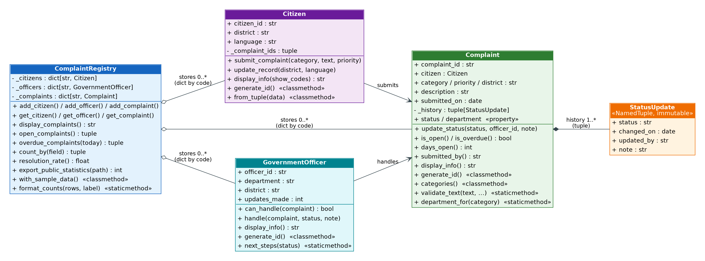

# Citizen Complaint System (CCS)

An open-source, privacy-respecting Python program that lets citizens in Sierra
Leone **report problems with public services** (roads, water, electricity,
waste, health, education, security and corruption) and **track them until they
are fixed**. Each complaint goes automatically to the responsible government
department, follows a clear workflow, and keeps a permanent history of every
action taken. It is built with Object-Oriented Programming (OOP) and designed
to follow the **Digital Public Goods (DPG) Standard**.

> **Module:** PROG211 Object-Oriented Programming 1, Limkokwing University of Creative Technology, Sierra Leone
> **Assignment:** Real-World Solutions under DPG Standards
> **Domain:** Government (Citizen Complaint System)

> All sample data is fictional. Department names are used only to show how
> complaints are routed; this project is not affiliated with any agency.

---

## 1. The problem

When a road is damaged, a water point breaks or a public official asks for an
unofficial payment, citizens often do not know where to report it, and once
they do, they rarely hear what happened. Complaints are lost, nobody is
accountable for delays, and people who report corruption may fear being
identified.

CCS gives every complaint a tracking code (for example `CMP-0001`), sends it to
the right department, sets a target response time based on priority, flags
overdue cases, and records every status change in a history that cannot be
altered. Citizens are identified only by a code, and corruption reports are
kept confidential.

## 2. Features

| Feature | Description |
|---|---|
| Register citizens | Coded ID, district and preferred language only. No names or contact details. |
| Submit complaints | 9 categories, 4 priority levels, description checked for personal data. |
| Automatic routing | Each category is sent to its responsible department. |
| Tracking | Citizens follow progress with their complaint code. |
| Clear workflow | Submitted → Under review → In progress → Resolved, or Rejected. |
| Accountability | Officers can only update their department's complaints; a note is required to close one. |
| Service targets | Urgent 3 days, High 7, Medium 14, Low 30. Overdue complaints are flagged. |
| Whistleblower protection | Corruption reports hide the reporter's code from staff views. |
| Reports | Counts by category and status, resolution rate and average time to resolve. |
| Public statistics | CSV of totals by district and category, with no personal data. |

## 3. Quick start

**Requirements:** Python 3.8 or newer. No extra packages are needed.

```bash
git clone https://github.com/<your-username>/citizen-complaint-system.git
cd citizen-complaint-system

python main.py                    # interactive menu program
python demo.py                    # guided demonstration of every requirement
python -m unittest discover -v    # run the 34 automated tests
```

On some computers the command is `python3` instead of `python`.

## 4. Project structure

```
citizen-complaint-system/
├── ccs/
│   ├── __init__.py      # package entry point
│   ├── models.py        # Citizen, Complaint, GovernmentOfficer, StatusUpdate
│   └── registry.py      # ComplaintRegistry (dictionary) + add/display functions
├── tests/
│   ├── test_models.py   # tests for the classes
│   └── test_registry.py # tests for the registry and the menu program
├── docs/
│   └── class_diagram.png
├── main.py              # interactive command-line program
├── demo.py              # non-interactive demonstration
├── CONTRIBUTING.md
├── LICENSE              # MIT open-source licence
└── README.md
```

## 5. How the assignment tasks are met

### Task 1: OOP basics (classes, attributes, objects)

| Class | Key attributes | Key methods |
|---|---|---|
| `Citizen` | `citizen_id`, `district`, `language`, `complaint_ids` | `submit_complaint()`, `update_record()`, `display_info()` |
| `Complaint` | `complaint_id`, `citizen`, `category`, `priority`, `district`, `description`, `status`, `history` | `update_status()`, `is_open()`, `days_open()`, `is_overdue()`, `display_info()` |
| `GovernmentOfficer` | `officer_id`, `department`, `district`, `updates_made` | `can_handle()`, `handle()`, `display_info()` |
| `ComplaintRegistry` | `_citizens`, `_officers`, `_complaints` (dictionaries) | `add_complaint()`, `get_complaint()`, `count_by()`, `overdue_complaints()`, `export_public_statistics()` |
| `StatusUpdate` | `status`, `changed_on`, `updated_by`, `note` | immutable NamedTuple |

**Interaction between objects:**

1. A `Citizen` calls `submit_complaint(...)`, which creates a `Complaint`
   linked to that citizen and adds its code to the citizen's record.
2. A `GovernmentOfficer` calls `handle(complaint, ...)`. The officer first
   checks that its department is responsible (`can_handle`), then the
   complaint records the change with `update_status(...)`, and the officer's
   `updates_made` counter increases.



### Task 2: Python data structure (dictionary)

The single data structure chosen is the **dictionary**. Objects are stored with
their unique code as the key:

```python
self._complaints = {"CMP-0001": <Complaint>, "CMP-0002": <Complaint>, ...}
self._citizens   = {"CIT-0001": <Citizen>, ...}
self._officers   = {"OFF-0001": <GovernmentOfficer>, ...}
```

A dictionary is ideal for a tracking system: a citizen types a complaint code
and the record is found instantly, and duplicate codes are impossible. The
simple functions required by the brief are in `ccs/registry.py`:

```python
add_record(registry, record)   # adds a Citizen, GovernmentOfficer or Complaint
display_records(registry)      # loops through the dictionaries and prints every record
```

**Optional tuples (bonus):** each status change is a `StatusUpdate` named
tuple, and a complaint's history is a tuple of them, so the record of what was
done and when **cannot be rewritten** (an audit trail). Reference data
(districts, languages, categories, priorities, statuses) and report rows are
tuples too, and tuple unpacking is used in `Citizen.from_tuple()` and when
reading a status update.

### Task 3: Instance, class and static methods

| Type | Examples |
|---|---|
| Instance methods | `submit_complaint()`, `handle()`, `update_status()`, `days_open()`, `is_overdue()`, `display_info()` |
| Class methods (`@classmethod`) | `Citizen.generate_id()`, `Citizen.from_tuple()`, `Complaint.categories()`, `ComplaintRegistry.with_sample_data()` |
| Static methods (`@staticmethod`) | `Complaint.validate_text()`, `Complaint.department_for()`, `GovernmentOfficer.next_steps()`, `ComplaintRegistry.format_counts()` |

## 6. Alignment with the Digital Public Goods Standard

| # | DPG indicator | How CCS meets it |
|---|---|---|
| 1 | Relevance to the Sustainable Development Goals | Supports **SDG 16 (Peace, Justice and Strong Institutions)**, especially targets on reducing corruption and building accountable, transparent institutions, and **SDG 11 (Sustainable Cities and Communities)** through better public services. |
| 2 | Use of an approved open licence | Released under the **MIT Licence** (see `LICENSE`). |
| 3 | Clear ownership | Copyright holder stated in `LICENSE`; code publicly hosted on GitHub. |
| 4 | Platform independence | Pure Python standard library: no paid software, no internet connection and no proprietary dependencies. |
| 5 | Documentation | This README, docstrings on every class and method, a guided `demo.py` and 34 automated tests. |
| 6 | Mechanism for extracting data | Menu option 9 exports public statistics to **CSV**, an open format, supporting open government. |
| 7 | Adherence to privacy and applicable laws | **No names, phone numbers, ID numbers or email addresses are stored.** Citizens are identified by a generated code. Complaint descriptions and officer notes are automatically checked and rejected if they contain a phone number, ID number or email address. |
| 8 | Adherence to standards and best practices | PEP 8 style, type hints, ISO 8601 dates (`YYYY-MM-DD`), a defined status workflow, input validation and unit tests. |
| 9 | Do no harm by design | **Whistleblower protection**: corruption reports hide the reporter's code, and staff lists of citizens never show who made which complaint. The status history cannot be edited, so officers cannot hide delays. Public statistics contain only totals. |

### Inclusive and accessible design

- Citizens choose a preferred language: **English, Krio, Mende, Temne or Limba**.
- Plain-language, numbered menus that work with screen readers; no
  information depends on colour.
- Options can be chosen by **number or name**; text is case-insensitive.
- Sensible defaults: press Enter to use your own district, Medium priority or
  English.
- Every error explains how to fix it; after three wrong answers the user goes
  back to the main menu instead of being trapped.
- Works fully offline on low-cost computers, such as in a council office or
  community centre.

### Modular and reusable

The `ccs` package contains no `input()` calls, so its classes can be reused by
a web portal, a mobile app or an SMS/USSD service without changes. `main.py` is
only one interface built on top of them.

## 7. Example usage (sample input and output)

### Registering and submitting a complaint (privacy protection in action)

```
Choose an option (0-10): 1

Register as a citizen
---------------------
Privacy notice: we do not collect your name, phone number or ID number.
Keep the citizen code shown at the end; you need it to submit complaints.
Your district (number or name): Freetown
  Error: District not recognised. Type its number or its name. (2 attempt(s) left)
Your district (number or name): 16
Preferred language (press Enter for English): 2
Success: you are registered with citizen code CIT-0001.

Choose an option (0-10): 2

Submit a complaint
------------------
Your citizen code: CIT-0001
What is the problem about? (number or name): 1
District where the problem is (press Enter for Western Area Urban):
How urgent is it? (press Enter for Medium): 3
Describe the problem in 10-300 characters.
Do not include names, phone numbers or email addresses.
Description: Call me on 076 123 456 about the potholes.
  Error: For privacy, the description must not contain phone numbers, ID numbers or email addresses. (2 attempt(s) left)
Description: Large potholes on the main road near the market make it unsafe.
Success: complaint CMP-0001 submitted.
It has been sent to: Sierra Leone Roads Authority.
Target response time for High priority: 7 days.
Use option 3 with your complaint code to track progress.
```

### An officer updates it and the citizen tracks it

```
Choose an option (0-10): 5

Update a complaint (officers)
-----------------------------
Your staff code: OFF-0001
Complaint code: CMP-0001
New status (number or name): 1
Note (optional, press Enter to skip): Site inspection scheduled.
Success: CMP-0001 is now 'Under review'.

Choose an option (0-10): 3

Track a complaint
-----------------
Complaint code: CMP-0001
Complaint CMP-0001 | Roads | High priority | Western Area Urban | Status: Under review
   Submitted 2026-10-19 by CIT-0001 | Responsible: Sierra Leone Roads Authority
   "Large potholes on the main road near the market make it unsafe."
   2026-10-19  Submitted     by Citizen   Complaint received.
   2026-10-19  Under review  by OFF-0001  Site inspection scheduled.
Open for 0 day(s); target is 7 day(s).
```

### Open and overdue complaints (after loading sample data)

```
CMP-0003 | Waste collection | Medium | In progress  |  91 days  OVERDUE
CMP-0004 | Water supply     | High   | Under review |  77 days  OVERDUE
CMP-0005 | Health services  | Medium | Submitted    |  68 days  OVERDUE
CMP-0006 | Corruption       | High   | Under review |  62 days  OVERDUE
CMP-0008 | Electricity      | Medium | Submitted    |  39 days  OVERDUE
CMP-0010 | Education        | Low    | Submitted    |  21 days
Open: 6 | Overdue: 5
```

(The day counts depend on the date you run the program.)

### Reports

```
Status                  Complaints   Share
------------------------------------------
Resolved                         3     30%
Submitted                        3     30%
Under review                     2     20%
In progress                      1     10%
Rejected                         1     10%
------------------------------------------
Total                           10

Resolution rate: 30.0% of all complaints
Average days to resolve: 7.0
```

### Public statistics export (`public_complaint_statistics.csv`)

```
district,category,total,open,resolved,rejected
Bo,Electricity,2,1,1,0
Bombali,Corruption,1,1,0,0
Kenema,Education,1,1,0,0
...
```

### Using the classes in your own code

```python
from ccs import Citizen, ComplaintRegistry, GovernmentOfficer, add_record, display_records

registry = ComplaintRegistry()
citizen = Citizen("Bo", "Mende")
officer = GovernmentOfficer("Electricity Distribution and Supply Authority", "Bo")

complaint = citizen.submit_complaint("Electricity", "Street lights broken for a month.", "Medium")
officer.handle(complaint, "Under review", "Technician assigned.")

for record in (citizen, officer, complaint):
    add_record(registry, record)
display_records(registry)
print(complaint.status)   # Under review
```

## 8. Testing

```bash
python -m unittest discover -v
```

The 34 tests cover object creation, validation, privacy checks, the status
workflow, department permissions, overdue logic, confidentiality, the
dictionary registry, the public export and complete scripted sessions of the
menu program.

## 9. Limitations and future work

- Data is kept in memory while the program runs; secure storage in a database,
  with log-in for officers, would be the next step.
- Messages are in English; translating the interface into Krio, Mende, Temne
  and Limba would complete the language support.
- An SMS/USSD channel would let citizens without smartphones submit and track
  complaints.

## 10. Licence

Released under the [MIT Licence](LICENSE).
